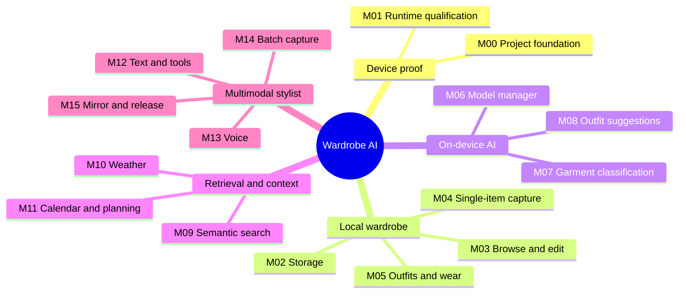

# Wardrobe AI delivery mind map

This map groups the [roadmap milestones](../ROADMAP.md) by the behavior they deliver. The linked milestone index below is the source of truth for dependencies and acceptance.

| Branch | Roadmap cards |
| --- | --- |
| Device proof | [M00](../ROADMAP.md#m00--project-and-delivery-foundation) · [M01](../ROADMAP.md#m01--runtime-and-device-qualification) |
| Local wardrobe | [M02](../ROADMAP.md#m02--database-and-file-storage) · [M03](../ROADMAP.md#m03--wardrobe-browsing-and-editing) · [M04](../ROADMAP.md#m04--single-item-capture-and-cutout) · [M05](../ROADMAP.md#m05--saved-outfits-and-wear-history) |
| On-device AI | [M06](../ROADMAP.md#m06--model-provisioning-and-lifecycle) · [M07](../ROADMAP.md#m07--automatic-garment-classification) · [M08](../ROADMAP.md#m08--outfit-suggestions-and-explanations) |
| Retrieval and context | [M09](../ROADMAP.md#m09--semantic-wardrobe-search) · [M10](../ROADMAP.md#m10--optional-weather-context) · [M11](../ROADMAP.md#m11--calendar-and-outfit-scheduling) |
| Multimodal stylist | [M12](../ROADMAP.md#m12--text-stylist-with-bounded-tools) · [M13](../ROADMAP.md#m13--voice-input) · [M14](../ROADMAP.md#m14--batch-garment-capture) · [M15](../ROADMAP.md#m15--still-photo-mirror-fit-check-and-demo-release) |

The 17 October demo path was M00–M08. Feature code through M15 is now merged, but the iPhone 17 runtime and end-to-end acceptance evidence remain open. The manual wardrobe is the available offline fallback until the device gate passes.
