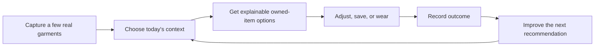

# Wardrobe AI product delivery plan

**Status:** proposed delivery sequence  
**Updated:** 18 October 2026  
**Companion research:** [competitor analysis](competitor-analysis.md)  
**Technical milestone history:** [ROADMAP](../ROADMAP.md)

## Objective

Make Wardrobe AI the fastest trustworthy way to decide what to wear from clothes a person already owns. The product must complete one loop before it broadens:

The plan prioritizes that loop before visual try-on, social features, retailer integrations, or a marketplace.

## Delivery rules

1. Ship one phase at a time. A phase starts only after the preceding phase’s acceptance criteria are met.
2. Each feature has a useful manual or offline fallback. No model, weather, calendar, or network failure may block wardrobe access.
3. The deterministic engine creates and validates candidates. Ollama can rank valid candidates but cannot invent garments, change wear history, or provide unverified reasoning.
4. Ask for permissions only at the moment of use. Calendar, location/weather, and remote Ollama are optional and independently revocable.
5. Measure a feature before adding adjacent complexity. Retention and recommendation outcomes determine whether later phases are worth building.
6. Implement each work package as a dedicated branch/PR under the existing roadmap workflow. Preserve the current in-review milestone work; do not mix this plan into it.

## Priority map

| Priority | Phase | Outcome | Why now |
| --- | --- | --- | --- |
| Essential | 0 | Stabilize the existing daily recommendation contract | A dependable baseline is required before collecting feedback or adding more context. |
| Essential | 1 | Contextual Today and Compose | Solves the morning decision with controls users can understand. |
| High | 2 | Planner, packing, and visual look memory | Converts occasional use into weekly and travel retention. |
| High | 3 | Learning, analytics, and wardrobe maintenance | Makes the system improve and keeps larger wardrobes usable. |
| Medium | 4 | Wishlist and purchase-gap decisions | Extends the product to smarter buying without becoming a shopping feed. |
| Later | 5 | Visual try-on, collaboration, repair/resale, sync | Valuable but costly, privacy-sensitive, or dependent on mature data. |

---

## Phase 0 — recommendation contract and observability

**Goal:** make every current recommendation safe, explainable, and measurable.

### Included work

- Keep candidate construction deterministic and owned-item-only.
- Preserve the selected anchor, occasion, weather freshness, preferences, recent wear, and completeness as explicit inputs.
- Show a “Why this look?” sheet with the actual scoring factors and each item’s role.
- Add structured recommendation events: generated, viewed, saved, worn, skipped, and failed-to-generate.
- Record source state for each outcome: local rules, Ollama ranking, cached weather, or no context.
- Add development fixtures representing sparse, work, formal, rain, hot, travel, and large wardrobes.

### Data additions

`recommendation_events`: candidate IDs, immutable context snapshot, generation source, user outcome, and timestamp. Store no raw chain-of-thought or free-form model diagnostic text.

### Acceptance criteria

- Every displayed item exists and is available in the local wardrobe.
- Every visible reason maps to known item metadata or an explicit input.
- A missing model, weather key, or calendar permission still returns useful local options.
- At least ten fixed wardrobe/context fixtures pass candidate validity and explanation-source assertions.
- The app can answer “why did I see this?” without contacting Ollama.

### Exit metric

At least 95% of generated recommendation events have a visible explanation and no invalid item IDs in internal fixtures.

---

## Phase 1 — Contextual Today + Compose

**Goal:** reduce a morning wardrobe decision to under a minute while leaving the user in control.

### Work package 1.1 — Today context

Add an expandable Today context card:

- Occasion and optional dress-code note.
- Weather with fresh, cached, stale, and unavailable state.
- Optional calendar event context with titles hidden from diagnostics and never written back.
- Constraints: warmth, rain tolerance, walking/comfort, availability, and preference to repeat or avoid recently worn pieces.

**Design:** all fields are visible, editable, and removable before generating. Context is never silently inferred from an event title.

### Work package 1.2 — Compose

Replace the single-anchor picker with a composition builder:

- Lock one to three owned garments.
- Choose open slots: complete look, footwear, outerwear, accessory, or “choose for me.”
- Reject incompatible primary combinations before generation, explaining why.
- Generate three candidates that preserve locked pieces.
- Replace a single component without rebuilding the look.

**Ranking requirements:** choose only from owned, available items; balance category completeness, occasion evidence, weather, formality, recency, preferences, and explicit constraints.

### Work package 1.3 — outcome feedback

Place these actions on every candidate:

- **Wear today** — creates an idempotent wear event.
- **Save for later** — saves a look without logging wear.
- **Not for today** — opens optional reasons: wrong occasion, weather, comfort, color, formalness, or something else.

Never treat Save as Wear. Never use skipped looks as negative preference without user confirmation.

### Data additions

| Entity | New fields / relationships |
| --- | --- |
| Garment | availability status: active, laundry, repair, stored, archived. |
| Recommendation event | locked IDs, requested slots, context snapshot, outcome, optional outcome reason. |
| Style preferences | explicit comfort, formality, footwear, color, and repeat-frequency preferences. |

### Acceptance criteria

- A user can lock a top and trousers and receive footwear-only or outerwear-only choices.
- A user can lock a shoe, bag, outer layer, or dress and receive complete compatible looks.
- Changing one constraint refreshes only the recommendation state; it never modifies garments or wear history.
- Weather and calendar denial paths remain useful and truthful.
- Replace preserves all other locked and accepted items.
- Dynamic Type, VoiceOver labels, cancellation, and no-network paths are covered.

### Success metrics

| Metric | Initial target |
| --- | --- |
| Time from opening Today to a saved or worn look | Median under 60 seconds |
| Generated look that is saved or worn | 25%+ |
| Recommendation dismissed as irrelevant | Below 35% |
| Week-one users receiving a complete look | 50%+ |

### Implementation order

1. Database migration and repository tests for availability and recommendation events.
2. Context model and deterministic scoring updates.
3. Compose UI and component replacement.
4. Outcome actions and event logging.
5. Optional weather/calendar wiring, fixtures, accessibility, and device validation.

---

## Phase 2 — Planner, packing, and visual memory

**Goal:** make Wardrobe AI useful before the day starts and before a trip.

### Work package 2.1 — Planner

- Dedicated week view with planned, worn, and unscheduled looks.
- Drag or accessible action to reschedule a look.
- Optional read-only calendar event context.
- Clear separation between plan and actual wear.

### Work package 2.2 — Trip and packing

- Trip destination, dates, activities, luggage constraints, and weather context.
- Generate a packing collection from saved/planned looks.
- Deduplicate garment list, track packed state, and identify missing required roles.
- Offline printable/exportable packing checklist.

### Work package 2.3 — visual look memory

- Free-form outfit board using existing garment cutouts.
- Optional OOTD photo attached to a wear event.
- Notes about comfort, confidence, weather, and alterations.

### Acceptance criteria

- Moving a plan never logs a wear.
- Packing lists include each item once and show which looks rely on it.
- Deleting or archiving an item identifies affected plans and looks.
- OOTD photos are private by default and removable with the wear event.

### Success metrics

- Planned looks per weekly active user.
- Packing-list completion rate.
- Percentage of planned looks later logged as worn.

---

## Phase 3 — learning, analytics, and maintenance

**Goal:** help users maintain a useful wardrobe and improve future suggestions without opaque profiling.

### Work package 3.1 — analytics

- Wear count, time since last wear, underused/overused items, and outfit reuse.
- Cost-per-wear and wardrobe value only after price and purchase-date data exist.
- Filters by date range, category, season, availability, and wardrobe.

### Work package 3.2 — maintenance

- Bulk edit, archive, restore, and lifecycle status.
- Storage location, care reminder, repair state, donation, resale, and seasonal capsule collection.
- Multiple wardrobes or collections: everyday, work, travel, seasonal, household member.

### Work package 3.3 — transparent preference learning

- Recommend a preference change only after repeated explicit signals.
- Show the evidence: “You saved 8 relaxed looks and skipped 6 formal looks this month.”
- Allow one-tap accept, edit, reset, and disable.

### Acceptance criteria

- Analytics derive from immutable wear events, not mutable counters.
- Archived, laundry, repair, or stored items are excluded by default and can be deliberately included.
- Users can export or erase preference-learning data separately from their wardrobe.

---

## Phase 4 — buying decisions and wardrobe gaps

**Goal:** help users buy less and buy better.

### Included work

- Private wishlist item: product URL or photo, price, desired role, and notes.
- “Can I style this?” generates looks mixing a prospective item with owned items, clearly labeling it as unowned.
- Gap analysis: identify missing roles only when user context and repeated failed compositions support the claim.
- Duplicate and overlap warning based on category, color, formality, and existing outfit utility.
- Price-drop and retailer integration remain out of scope until consent, affiliate disclosure, and product-data quality are established.

### Acceptance criteria

- Never represent a wishlist item as owned.
- Every buying suggestion cites its gap evidence and has a dismissal path.
- No sponsored source can alter neutral gap analysis without an explicit disclosure.

---

## Phase 5 — advanced visual, collaboration, and platform capability

**Goal:** expand only after the core loop has strong retention and data quality.

| Work package | Include when | Key guardrail |
| --- | --- | --- |
| Virtual try-on | Users repeatedly use visual planning and explicitly request preview support. | Consent, deletion, representation limitations, no body or health judgments. |
| Sharing and styling | Users need partner, friend, or stylist collaboration. | Private by default; share individual looks/collections, not whole wardrobe by default. |
| Repair/resale handoff | Lifecycle status and item metadata are broadly adopted. | No marketplace lock-in; keep item data portable. |
| Backup and sync | Local data volume and multi-device demand justify it. | Encryption, restore drills, export, and conflict rules before launch. |
| Inspiration and community | Core retention is proven. | Separate inspiration from purchase pressure and keep recommendation provenance clear. |

---

## Explicitly deferred

- Always-on camera or continuous mirror video.
- Body-shape scoring, attractiveness scoring, or health/weight inferences.
- Automatic purchases, affiliate-driven recommendations, or retailer marketplace work.
- Social feed and public wardrobe discovery.
- Cloud sync before export, backup, and deletion controls are complete.
- Broad device-performance claims before measured qualification.

## Suggested PR breakdown for Phase 1

| PR | Scope | Depends on |
| --- | --- | --- |
| P1.1 | Recommendation events, garment availability, repository migration, and fixtures | Existing storage/outfit work |
| P1.2 | Context model, deterministic candidate/scoring changes, explanation ledger | P1.1 |
| P1.3 | Compose UI: locks, slots, candidate cards, Replace | P1.2 |
| P1.4 | Outcome feedback, preferences UI, analytics instrumentation | P1.1, P1.3 |
| P1.5 | Weather/calendar integration, accessibility, device validation, evidence | P1.2–P1.4 |

Each PR must include its relevant unit/integration checks, `git diff --check`, an iPhone build, and its actual device evidence. The phase is complete only when all listed acceptance criteria pass and the results are recorded in the relevant evidence document.
